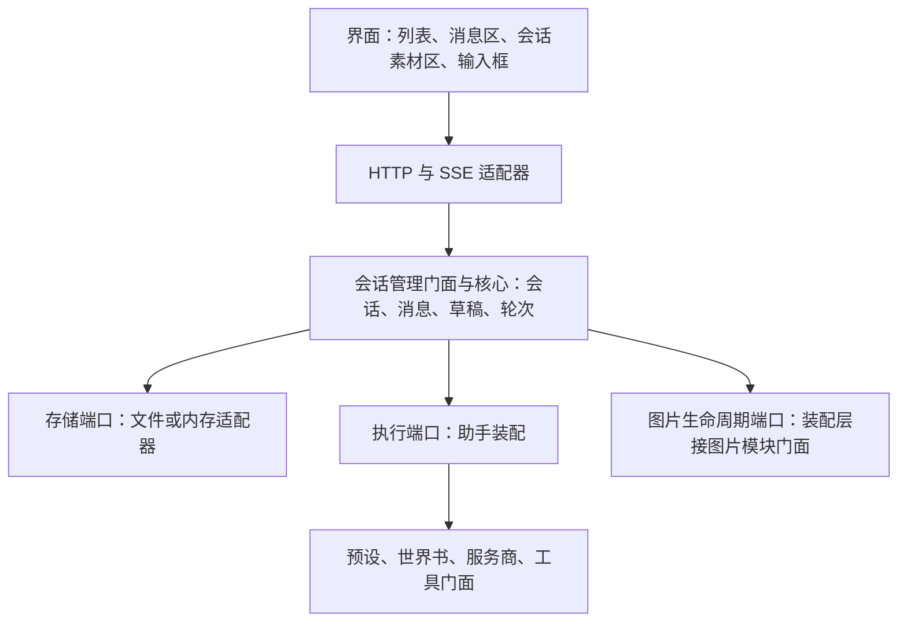

> 作废说明（2026-10-13）：本草案已被 [会话模块详细设计](../会话模块/README.md) 取代。研究其他模块并审核后，删除了 ZIP 归档、服务端当前选择、全量配置快照和提交去重等多余机制，修正了模块动作入口及图片删除竞争。素材池/草稿/消息的区分、图片按会话归属和分阶段保存的分析仍可复用；下文保留原文，不作为实施契约。

# 对话管理、会话区与图片的统筹设计草案

日期：2026-10-13。状态：供讨论的方案，未实施，不取代现行 `设计.md` 与接口。

范围是当前独立启动的助手。DSH 插件继续使用 DSH 自己的会话与循环，两种运行方式不同时写同一份会话文件。此次只分析本仓库。

## 一、结论

现有模块解决了文字聊天的状态集中问题，但还没有形成完整的多模态会话模型。需要补齐的是四件事的关系：会话、消息、轮次执行、图片素材。只给现有 `messages` 增加一个图片数组，不能解决删除、保存、工具产图和导入导出的问题。

建议将现有对话管理模块完善为六边形的会话管理模块，保留图片模块的三个存放地与跨存放地复制规则。会话管理维护会话记录、草稿和轮次，并负责会话生命周期的操作顺序；装配层通过端口接入图片能力与 AI 执行。模型协议与界面展示都是这些事实的投影。

完成设计的标准：每份数据有确定的所有者；保存单位明确；素材进入消息的路径明确；切换、停止、清空、删除和导入导出都有确定行为；失败与中断不被伪装成成功；没有新增图片索引、共享引用计数或隐藏 AI 流程。

## 二、现状与缺口

| 现状 | 代码依据 | 影响 |
|---|---|---|
| 对话模块已统一文字消息、当前选择、运行状态，读出口交副本 | `core.js`、`README.md` | 这个方向可以保留 |
| 页面组装 `imageIds`，助手客户端只把 `话` 交给服务端；核心也只投影文字 | `../对接层/界面/页/app-view.js:3166`、`我们的模块.js:1203`、`core.js:7` | 图片没有进入这条发送链；只有图片的发送还会被拒绝 |
| 会话图片列表固定为空，解析固定返回空，清空图片直接返回成功 | `../对接层/界面/页/我们的模块.js:1327` | 会话区没有接到真实图片存储 |
| 页面调用 `uploadSessionImage`、`removeSessionImage`，当前助手出口没有对应实现 | `../对接层/界面/页/app-view.js:2286`、`:2314` | 上传、从图库送入会话、移除等流程没有闭合 |
| 删除确认提供保留图片选项，助手删除方法未接收该选项；核心删除只移除会话对象 | `我们的模块.js:1246`、`app-view.js:3753`、`core.js:113` | 会话删除和图片生命周期脱节 |
| 所有会话共用一个 `会话.json`，每次保存重写全部正文；切换也走同一次全量保存 | `adapter-file.js:7`、`:16`、`core.js:39` | 保存成本受所有历史影响，单个文件承载所有会话 |
| 运行进展只更新内存，通常到整轮结束才保存；启动没有整理在途工具记录 | `core.js:51`、`:59`、`../对接层/界面/助手.js` | 长工具链中断可能丢失已完成步骤；其他操作恰好保存过在途状态时，重启可能留下没有回执的工具声明 |
| 导出只有会话 JSON，导入只换会话和消息 ID | `core.js:70`、`:95` | 不能携带图片，也没有图片引用重建规则 |
| 工具结果先把字节转成 dataUrl，再整体转成 JSON 字符串进入轨迹 | `../对接层/登记工具.js`、`../对接层/界面/助手.js:43` | 图片可能以大字符串进入会话和模型历史，界面也缺少明确的图片结果结构 |

这里还有一个具体冲突：`登记工具.js:85` 固定了 1 MB 工具字节上限，图片模块本身却不设图片大小上限。对话图片采用引用后，原图无需作为 JSON 字符串穿过这道限制；若仍有必要的传输限制，必须在界面与交付说明中明确表达，不能继续把常量当隐藏能力边界。

文档也有范围表述冲突：`项目说明.md` 前部仍写会话存储借 DSH，末尾已描述独立对话模块；`界面设计.md` 同时存在旧的“不做会话状态”表述和后加的会话管理决定。正式实施时需将独立模式与 DSH 模式的适用范围写清，不能靠阅读顺序猜。

上述缺口来自源码检查。本轮执行的现有验证：`node 对话管理模块/test/run.js` 通过；`node 图片模块/test/run.js` 41 条通过。这些结果证明已有基础行为，未证明会话与图片联动。

## 三、先定义四种事实

| 概念 | 内容 | 所有者 |
|---|---|---|
| 会话 | 稳定 ID、标题、创建和更新时间、消息、轮次、待发草稿 | 对话管理 |
| 消息 | 一次实际输入或模型输出，包括有顺序的文字、图片引用、推理和工具轨迹 | 对话管理 |
| 轮次 | 一次发送触发的执行，可能包含多次模型请求与多个工具调用 | 对话管理；执行动作交给注入的执行端口 |
| 图片素材 | 原始字节、图片副档、派生变体、存放地 | 图片模块 |

会话区定义为“当前会话的图片素材池”。池里的图片可能尚未发送，也可能已经用于多条消息，或者是工具刚返回的产物。

输入框的待发附件是本次草稿选中的图片。消息里的附件是这条消息实际携带的图片。两者都不等于整个素材池。

例如：会话区有十张图，用户选两张发送。会话仍有十张素材，这条用户消息只记录两张引用。发送完成后取消这次待发选择，十张素材都保留。下一条消息可以再次选择其中一张。

“已发送”从消息中的图片引用算出，不另存 `sent`。素材数量从图片模块的 `列` 算出，不另存计数。需要向 AI 提供素材标识清单时也从同一作用域读取；素材清单不等于把所有图片字节送给模型。

## 四、职责和调用关系



- **会话管理核心**不认识 HTTP、DOM、OpenAI 报文、图片物理目录或其他模块内部结构。它管理事实、状态转换、保存，以及删除保图等会话操作的执行顺序。
- **图片模块**不认识消息、轮次、当前会话选择或 AI 流程。它只按传入作用域读写图片。
- **装配层**把核心确定的 `sessionId / turnId / signal` 传入本轮执行，将图片生命周期端口接到图片模块门面，完成引用与回执形状的翻译。生命周期规则保留在会话核心，模块之间的依赖通过函数传入。
- **执行端口**读取预设与世界书、请求模型、调用同一份工具门面，提交本轮产生的消息与工具事实。模型决定调用顺序和何时结束。
- **界面**展示服务端状态与明确的本地编辑状态。会话素材卡与消息图片从同一个图片引用解析器取图。

HTTP 保留两类明确语义：会话生命周期动作走 `/对话/*`；图片等模块动作仍走 `/toolbox/调`。会话删除、带图片导出由 `/对话/*` 进入会话门面，核心通过端口完成编排；图片端口实现调用原图片门面，不另实现图片读写。HTTP 路由只转交动作与回执。

上传中的字节传输端点也只承担传输并进入同一门面，不另长出一套图片存储。页面只接收引用与显示数据，不自己拼盘上路径。

## 五、图片归属与引用

保留现有物理归属：

| 存放地 | 生命周期 |
|---|---|
| `session/<会话ID>/<图片ID>/` | 该会话拥有的图片 |
| `gallery/<图片ID>/` | 用户独立保存的图库图片 |
| `vision/<图片ID>/` | 识图工作区的独立副本 |

图库送入会话 A，通过 `取内容 → 存到 A` 得到新 ID。A 的图片送入 B，再产生 B 的独立副本。保存到图库、送识图工作区同理。图库原图删除不会破坏 A 的消息。

同一会话内，多条消息可以使用同一张素材，不逐条复制。会话内部的消息图片块只需记录图片 ID；所属会话来自外层。跨模块交接时由装配层组成图片模块现行的完整 `引用`。不在本次设计中重命名图片模块已有引用字段。

图片字节、尺寸、显示名等由图片副档保存，对话不再复制一份资产描述表。消息可以存“用户当时给这张图写的说明”，这是消息内容，不是图片显示名的镜像。

会话素材列表直接来自该会话的图片目录。未被消息引用的图片仍然是合法素材，不能作为“孤儿”自动清理。工具产图若已成功落盘但消息保存失败，也仍可在素材区找回，不需要额外资产清单。

解析图片必须携带所属会话，不能依赖界面此刻选中的会话。缓存键使用完整引用与变体，不能通过“先找当前会话，找不到再找图库”碰运气。

## 六、对话文件怎样保存

### 6.1 保存单位

建议每个会话一个 JSON 快照，图片仍由图片模块单独保存。实际根目录由装配层明确传入，下面只规定相对结构：

```text
<会话根>/
  界面状态.json
  <会话ID>/
    会话.json

<图片根>/
  session/<同一个会话ID>/<图片ID>/
    original.png
    meta.json
    ...图片模块已有派生变体
  gallery/...
  vision/...
```

会话目录使用 ID，不使用标题。改名只改字段，不移动文件。会话根与图片根不必在同一个盘；两者的关联是会话 ID，根目录只能由装配层确定，模块不探测位置。

会话存储应有自己的根目录语义，不继续作为 API 配置目录的下属业务。API 文件位置、图片内部布局及其他模块目录不由本草案顺带重排。具体 C/F 盘位置属于部署设置，不影响本设计。

`界面状态.json` 只保存上次选择的会话 ID 等界面偏好。切换会话不重写聊天正文。业务发送必须明确携带目标会话；“当前选择”只用于界面选择，不能在异步执行中重新取它定位。

### 6.2 一份会话快照的内容

| 字段组 | 保存的事实 |
|---|---|
| 文件格式 | `format`，本次数据结构的版本 |
| 会话身份 | `id / title / titleManual / createdAt / updatedAt` |
| `messages` | 唯一消息正文与工具轨迹 |
| `turns` | 每轮的 ID、触发消息 ID、执行状态、起止时间、实际使用的请求配置 |
| `draft` | 该会话尚未发送的文字与选中的图片 ID |

不保存第二份 `history`、界面 `blocks`、已发送图片表、图片概要表或全量原始请求日志。消息 ID、轮次 ID 和工具调用 ID 均稳定，用来对应更新与关联，不用数组位置定位异步结果。

消息内容建议采用有顺序的内容块：文字块保存正文，图片块保存图片 ID。推理、工具调用及工具结果各存一份。工具结果以结构化数据保存，图片结果使用明确引用，不先整个转成不可辨认的大字符串。展示字段如旧组件的 `text / imageIds / blocks` 由浏览器适配器现生成。

轮次配置记录“当轮实际用了什么”：链路标识与实际模型名、实际组装的系统及参考正文、实际工具定义与请求参数。它是历史快照，不参与修改活跃预设；后续编辑预设不改历史。快照不含 API Key，也不再复制一份全部消息正文。

### 6.3 为什么选快照

| 方案 | 评价 |
|---|---|
| 全部会话一个 JSON | 现状简单，但每次写入涉及全部会话；不选 |
| **每会话一个 JSON** | 本地个人项目易读、易导出，修改只涉及一个会话；推荐 |
| 每会话 JSONL 事件日志 | 追加方便，但要引入事件重放、修订、压缩和中断尾行处理；当前需求不需要这些成本 |

会话列表摘要在内存中计算，不另存一份需要对账的持久化索引。首版允许启动时读取会话文件建立摘要；这意味着启动读量仍随存档增长，不能声称只读目录就获得所有标题。正文按需交给页面，单会话更新不推送其他会话的全部历史。

保存方式使用同目录临时文件写完整快照，再替换正式文件。读取只认正式文件；读失败明确报告，不能当空会话覆盖。此方案处理文件写入中断，不承诺断电后的物理磁盘持久性，也不引入数据库或多套备份回退来源。

## 七、一次发送怎样执行

1. 在点击发送时固定目标会话、输入文字、图片选择与本次提交标识。允许只有图片的输入；没有文字且没有图片才是空输入。
2. 把用户消息、新轮次和草稿消费放在同一次会话保存中。保存成功才表示受理。失败则原草稿仍在，界面不显示发送成功。
3. 本轮读取并固定实际预设、世界书与工具定义，保存轮次使用信息。运行中编辑设置在下一轮生效。
4. 从唯一记录生成请求上下文，按明确引用取图片字节，由服务商适配器临时转换成模型需要的图文协议。
5. 模型产生工具调用时，先保存调用声明，再开始有副作用的执行。每个工具返回后保存结果，再继续下一次模型请求。
6. 助手完成时保存最终消息与轮次状态，释放运行位；停止和失败也通过同一生命周期收口，闸门在 `finally` 释放。

同一会话维持现有“一轮在飞”的行为，界面明确显示运行和停止状态。不同会话可以独立执行，不能为了保存方便把整个长请求放入全局串行队列。每次短提交由对话模块串行处理；图片写入继续由图片模块原有单一写队列处理。

一次明确提交只对应一个轮次。同一提交标识重复到达时返回已有受理结果，不再执行；依据存在该轮记录中，不另建去重表。相同文字的两次有意提交仍是两轮。界面收到 HTTP 受理和 SSE 消息后按消息 ID 更新同一行。

执行端口接收只读的本轮数据副本，通过一个提交入口追加或更新本轮消息、工具事实。它不能用整份消息数组替换过去所有历史。提交定位到原会话和原轮次，回复与工具产图不会因用户切换界面而改投另一条会话。

本版已有的模型整条接收可以继续使用。以后接流式，文字增量更新同一消息 ID；完成消息和每个工具阶段是落盘点，不能把“界面已经看见增量”宣称成“每个字符都已保存”。

## 八、记录、模型上下文与工具图片

### 8.1 两种投影

会话记录是事实源，界面投影负责气泡、图片和工具行；请求投影负责角色、图片编码、工具调用配对和世界书落点。对话核心不负责 OpenAI 特有字段。

程序错误、停止提示作为应用状态或系统通知展示，不冒充模型回答进入上下文。确实属于工具执行结果的错误则作为该工具的回执交给模型。

历史消息中的附件不因草稿勾选变化而改变。首版请求按历史消息保留原有图文关系，不自动去图、摘要、裁剪或偷偷改走其他模型。后续若需要上下文选择，应成为用户可见的功能；服务商不收图片或超限就如实报告。

已被用户物理删除的图片仍在历史记录中保留原引用，界面显示缺失状态。请求投影用“图片 ID + 读取错误”表达该附件已不可用，发送预览可见；不去其他存放地找同名图，也不拿识图标签冒充原图。

### 8.2 工具产图

新的图片字节若已作为工具结果返回，由装配层保存到**发起本轮的会话**，工具结果记录图片引用，界面由该结果投影图片，不重复保存一条伪造的助手消息。

这属于已返回内容的持久化协议，需要同时更新模块交付说明和界面说明，模型侧与界面侧读同一份结果。读取已有图片的动作使用已有引用，不因为读一次就在会话内复制一次。

ComfyUI 的“出图”如果只返回产出标识，仍然只返回产出标识；是否“取图”由 AI 或用户显式调用。装配层不能趁记录图片自动取图、收藏、挑最佳图或送识图。工具进出仍走同一个宿主门面。

对话文件不存原图 base64。只有真正构造模型请求或字节响应时才临时编码。工具回执中的 base64 文本不等于模型的原生视觉输入；用户附件由服务商适配器转换为图像块，工具图像怎样交给模型须遵守该服务商支持的协议，不能靠字符串伪装。

## 九、草稿、清空与删除的确定语义

| 用户操作 | 消息与轮次 | 素材文件 | 草稿与待发选择 |
|---|---|---|---|
| 取消一张待发附件 | 不变 | 保留 | 仅取消该图片的选择 |
| 切换会话 | 不变 | 不变 | 各会话保存并恢复自己的草稿 |
| 清空待发内容 | 不变 | 保留 | 清空输入与选择 |
| 清空对话记录 | 清空 | **保留** | 清空；界面写明“清空消息与待发内容，保留图片” |
| 从会话区删除一张图片 | 保留历史引用，展示缺失 | 调图片模块删除 | 移除对应待发选择 |
| 清空会话图片 | 历史引用保留并展示缺失 | 清空本会话作用域 | 清空图片选择，保留输入文字 |
| 删除会话 | 删除该会话记录 | 清空本会话作用域 | 随会话删除 |
| 删除会话并保留图片 | 删除该会话记录 | **先全部复制到图库，再清空会话作用域** | 随会话删除 |

运行中的会话仍须停止并结束本轮后，才能删除会话或清空记录，避免输出失去归属。切换、改名不取消执行。停止只取消可取消的执行，不撤销已经完成的保存、出图等副作用；已经提交到外部系统的任务是否停止，以外部实际结果为准。

删除会话由会话门面的一个动作完成，而不是让页面先删除记录，再指望另一处监听器清图。核心决定先保图、再清图、最后删除会话记录，具体图片操作交给注入的端口。保留图片选项也在这次删除操作中执行，不能只作为提示。

跨模块删除不假装是原子的。保图复制失败时，不开始清空源图，不删除会话；已生成的图库副本在失败回执里列明。图片清空部分失败或最后的会话文件删除失败时，保留会话管理入口，报告已完成项与未完成项，不能回“全部成功”。图片模块已有的移出可见范围、待回收和不回滚语义继续适用。

会话素材已经删除后，消息引用缺失是显式删除的结果，不通过自动改写历史去掩盖。该行为及数量应在删除界面可见。

## 十、中断和刷新

轮次至少区分运行、停止中、完成、已停止、失败、异常中断。持久化的是执行事实；进程内 AbortController 不落盘。

重启发现未完成轮次时，将其标为异常中断，保留已保存的用户消息、模型回复与工具结果。尚未开始的工具和执行途中失联的工具要区分：后者只能说“结果未确认”，不能断言没有副作用。

请求投影给每个工具调用提供对应回执；未知结果使用明确的中断说明，不能拼出悬空工具声明。不会自动重跑这轮、补做工具或恢复外部任务；继续或重新发送由用户决定。

页面刷新只重取状态，不再次发送。HTTP/SSE 以会话 ID、消息 ID 和版本同步；服务端进程实例标识用于辨认重启，避免浏览器拿旧进程的大版本号拒收新进程状态。侧栏接收摘要，打开的会话接收详情，图片字节走原有字节路。

## 十一、导出与导入

“完整导出会话”应是可独立携带的归档包，而不只是 JSON：

```text
会话导出.zip
  format.json
  conversations/<包内会话标识>/会话.json
  images/<包内会话标识>/<包内图片标识>/
    original.<扩展名>
    meta.json
```

导出范围是所选会话的记录与**全部现存素材**，包含尚未发送的图。派生变体不是原图，按图片模块能力决定导出或重建，原始字节保持不变。历史引用中已经删除的图片在包中明确记录为缺失，不承诺找回。纯文字或单 JSON 导出可以作为另一个明确命名的用途，不能叫完整备份。

导出由会话门面统一提供：核心确定导出会话与快照区间，经图片端口取得素材；端口实现调用图片门面 `列 / 取详情 / 取内容`。归档文件编码由适配器完成。不能在图片与消息被修改一半时宣称导出一致，也不能直接猜另一个模块的盘上文件位置。

导入创建新会话、新消息、新轮次、新工具调用及新图片 ID。图片经图片模块的 `存` 写入目标会话；建立包内标识到新标识的映射，重写所有结构化关联，然后发布新会话。

只有显式的引用字段参与重写，不在自由正文或任意 JSON 字符串里搜索替换 ID。历史原始参数中的文字仍是历史文字，不自动再次执行；可操作附件与结构化图片结果提供新标识，续聊使用当前素材清单。新结构中的可操作图片引用应采用统一显式结构，避免再次把它们藏在字符串里。

导入不携带运行中的执行器，不自动发消息，不导入 API Key。未结束的执行记录以中断状态落地。单个会话在素材与记录就绪后才进入会话列表；失败时报告已存图片等实际结果，不自动清理成“无事发生”，也不发布半条可用会话。

这是显式导入能力，不是旧存档兼容或迁移。不新增旧 ID 别名、旧格式回退或多级查找。

## 十二、六边形模块与接口收敛

### 12.1 完善现有模块

统一将这个职责称为会话管理。以现有 `对话管理模块/` 为基础完成设计；目录是否改名在实施时统一处理，不新增一个与它并存的会话模块。

现有模块已经有核心、文件与内存适配器、注入的执行函数，具备六边形雏形。需要补齐正式端口契约，并将完整生命周期规则放回核心。它属于应用状态层，七个能力模块的平级关系保持不变。

```text
会话管理模块/
  index.js                 唯一门面、动作声明与构造出口
  core.js                  会话事实、轮次状态与生命周期编排
  port.js                  存储、执行、图片生命周期的端口契约
  adapter-file.js          会话文件与界面偏好的存储实现
  adapter-memory.js        相同存储契约的内存实现
  test/                    从公开门面验行为
  README.md
  设计.md
  接口.md
```

执行端口与图片端口的真实接线放在装配层，测试使用注入的内存图片与假执行实现。核心不引入图片模块或模型模块的内部文件。端口按会话操作需要定义，不把整个图片模块对象或整个宿主递进核心。

验明六边形的标准是：不启动 HTTP、浏览器、模型服务和真实磁盘，也能通过同一个门面验证图文发送、原会话归属、停止、删除保图及导入导出关联。文件、网络、模型和图片内部的细节在各自适配器内。

### 12.2 对外与内部接口

无需把图片和对话合成一个大模块，也无需增加新的通用调度框架。

对话门面提供三类能力：同步读取列表摘要与指定会话；异步提交会话动作；订阅状态变化。动作沿用新建、改名、发送、停止、清空、删除和导入导出等用户语义，图片普通操作仍复用图片动作。

内部只需要几处清晰接口：

| 接口 | 要隐藏的工作 |
|---|---|
| 会话存储端口 | 按会话 ID 列、读、写、删，以及独立的界面偏好保存；文件与内存实现同契约 |
| 本轮执行端口 | 预设与世界书装配、模型请求、工具循环和取消 |
| 本轮事实提交入口 | 按原会话与原轮次追加/更新消息、工具与状态，保存并通知 |
| 图片生命周期端口 | 为删除保图、清空与完整归档提供所需图片操作；真实实现调用图片门面，核心掌握操作顺序 |

失败继续使用 `{ ok:false, code, reason }`，理由为 `码: 人话`。读返回副本，写返回 Promise。字段与具体动作契约在实施前再收进 `接口.md`，不让浏览器反过来定义核心存储格式。

## 十三、实施顺序与验收场景

建议按以下阶段实施，每阶段独立验收后再继续：

1. **记录与保存**：确定内容块、轮次、草稿，改为按会话保存，建立请求与显示投影。
2. **会话图片闭环**：接通素材区、图文发送、图库复制、工具图片结果与原会话归属。
3. **完整生命周期**：清空与删除、阶段保存、中断恢复、带图片导入导出。
4. **界面与文档收口**：消除空实现与失实的成功提示，更新界面语义与两种运行模式的适用说明。

必须覆盖的实际场景：

- 一次 Enter 对应一个用户消息和一个轮次；HTTP/SSE 不重复渲染，重复受理不重复执行。
- 纯图片、图文混合均能发送，服务商确实收到图片内容块。
- 素材区十张图只选两张，消息和模型请求均只挂这两张；刷新仍能还原。
- 图库图送入会话后删除图库原图，历史消息仍能看图。
- A 正在请求或产图时切换 B，结果、图片、停止目标仍属于 A。
- 清空消息后图片还在，后续模型请求没有旧消息；取消待发不删图片。
- 删除一张素材后历史明确显示缺失，后续请求不偷偷找其他图替代。
- 删除会话但保图：所有素材进入图库；任一阶段失败回执反映实际状态。
- 第一项工具完成、第二项未完成时中断进程：重启保留第一项结果，第二项显示结果未确认，不自动重跑。
- 导出包含未发送素材；导入后所有可操作引用指向新会话图片；移开原会话后新会话仍能看图和继续说话。
- 保存失败不伪装成发送成功；单个会话写入不重写其他会话；文件与内存端口行为一致。

## 十四、建议决定记录

以下尚是草案决定，正式实施时纳入现行设计的编号记录；被替代的规划保留原文并按仓库约定归档。

| 编号 | 建议决定 | 理由 |
|---|---|---|
| P-1 | 会话管理是应用状态模块，保持七个能力模块平级边界 | 生命周期必须集中，图片存储不需要认识聊天 |
| P-2 | 会话区是素材池，草稿选择与消息附件分别定义 | 未发送素材、历史附件与本次发送具有不同语义 |
| P-3 | 图片按会话归属，跨存放地与会话复制 | 延续现行图片设计，无共享引用计数和删除联动表 |
| P-4 | 每会话一个 JSON 快照，选择状态独立保存 | 缩小保存单位，适合本地个人项目 |
| P-5 | 正文只存一份，模型与界面各自投影 | 解决多模态、协议与界面互相牵扯 |
| P-6 | 工具执行前记录声明，结束后记录结果 | 让已执行副作用对应可恢复的事实，不靠整轮结束保存 |
| P-7 | 图片字节归图片模块，工具记录使用结构化引用 | 避免原图 base64 长驻会话及字符串回执 |
| P-8 | 删除、保图与归档由会话核心编排，图片执行经装配层注入的端口完成 | 决定在用户做出决定的操作里执行，规则能通过模块门面独立验证 |
| P-9 | 中断保留已知事实，不自动重放 | 工具副作用可能已经发生，不能伪造已回滚或替用户决定重试 |
| P-10 | 先完成线性会话，不预置分支树、队列、摘要或隐式裁剪 | 当前问题不需要这些额外机制；未来需求明确后再设计 |
| P-11 | 将现有对话管理完善为六边形的会话管理模块 | 统一门面与端口，集中生命周期规则，不增加并行的会话实现 |
