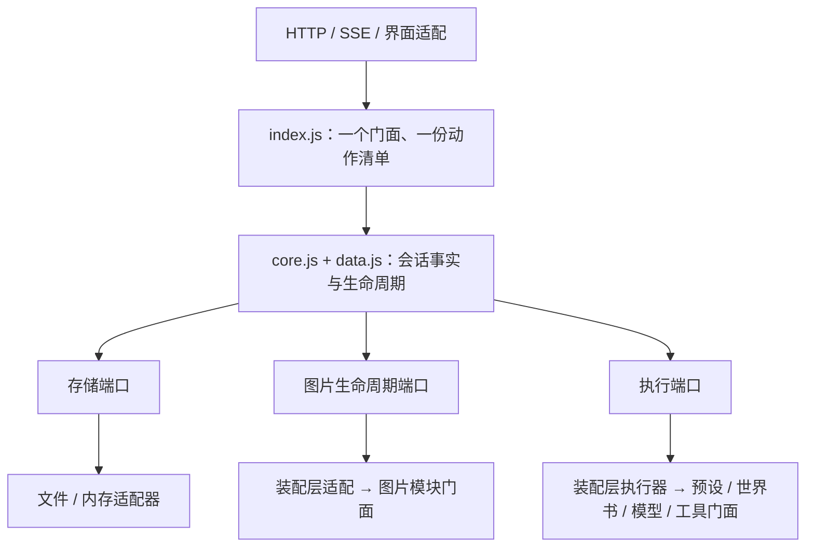

# 会话模块设计

状态：2026-10-13 确定并已实施的设计。数据和接口的唯一契约在 [接口.md](接口.md)，框架改动与验收在 [对接实施.md](对接实施.md)。

## 1. 职责

V1.5.15 的执行端口提供绑定本轮的 `notify()`，用于在不写会话文件的情况下发布执行器进度变化。业务进度仍由装配层持有，会话只递增版本并发布原有通知，不新增业务状态表。

会话模块是一份应用基础能力，负责：会话身份和标题；唯一消息记录；每会话草稿；一次发送对应的一轮执行；保存与中断；清空、删除、保留图片和完整归档。

七个业务能力模块保持原有平级关系。本模块与主 AI 一样由宿主装配，使用同样的门面和端口规范。它不接管主 AI 预设、世界书选择、模型协议、图片存储实现或业务工具决定。

### 1.1 四种对象

| 对象 | 权威数据 | 所有者 |
|---|---|---|
| 会话 | ID、标题、消息、轮次、草稿 | 会话模块 |
| 消息 | 实际图文内容、推理和工具轨迹 | 会话模块 |
| 轮次 | 哪条用户消息触发、运行结果、起止时间 | 会话模块 |
| 图片 | 原始字节、副档、派生变体、物理归属 | 图片模块 |

会话区是会话素材池，由图片模块该会话作用域的目录枚举生成。草稿是下一次发送准备的内容，消息是已受理的事实。素材可以不发送，可以多次发送；一张会话图片可被本会话多条消息使用。

已发送标志、素材数量、消息展示块、模型 history 全部现算。不存在会话资产概要表、引用计数或未引用图片清理。

### 1.2 六边形

核心只使用注入端口及 JavaScript/Node 的非 I/O 能力。ID 默认用 `node:crypto.randomUUID`，复制用 `structuredClone`。核心不引入 fs、path、HTTP、DOM、服务商 SDK 或其他模块文件。

会话核心决定删除时先保图再清图，以及何时保存消息；图片端口执行具体图片操作。装配层的适配函数翻译公开字段，不再次决定生命周期。

## 2. 保存单位

每个会话保存为 `<会话根>/<会话ID>.json`。使用平铺文件，文件名与标题无关。默认根由宿主配置 `会话目录: '工具箱数据/会话'` 解析，不从 API 目录或旧会话目录回退。

图片继续使用已有 `<图片根>/session/<同一会话ID>/<图片ID>/`，图库与识图工作区保持既有布局。两个根可以不同，只靠明确标识关联。

会话文件只有一份正文。文件适配器负责 JSON 编解码；核心接收已解析的本模块数据。每次写入完整的单会话快照，使用同目录临时文件写完后改名替换正式文件。改名失败保留原正式文件并返回失败；本次临时文件尽力移除，残留不作为读取来源。不做备份链、WAL、事件重放或数据库。

读取正式 `.json` 文件；只接收合法会话 ID 文件名。根不存在表示空库；根不可读返回失败。单文件无法解析或版本不支持，在列表报告该会话读不懂，冻结它的内容写入；其他会话正常使用。删除该会话仍可按文件名 ID 执行。

构造时读取全部会话到内存 Map。首版有意接受启动读取全部会话文件的成本，换取简单实现。列表摘要从这份状态算出，不另存索引。每次成功写入仅涉及目标会话。运行期间不自动监视外部文件修改。

当前选择与滚动位置属于界面，继续使用现有 preferences/localStorage 保存；模块没有“当前会话”字段，也没有 `换` 动作。所有目标会话操作必须显式指定会话 ID。

## 3. 消息和轮次

消息只存一次，图文内容以有序 parts 表达。消息可以是 user 或 assistant；程序停止/失败提示由轮次状态显示。工具调用属于产生它的 assistant 消息，每项声明、参数、状态、结果只存一次。

轮次记录只保存身份、触发用户消息、时间、状态和失败回执。实际模型信息可记录在对应 assistant 消息。按深度世界书参考正文保存到触发用户消息的 context。当前预设、系统提示词与工具定义由执行器在每轮开始时固定，并在该轮请求中使用，不复制成另一份历史配置库。

本版不实现精确请求回放或全量配置审计，因此不保存每轮完整 tools/system 快照。现有预设/世界书预览保留原用途，界面补充会话格式说明和实际缺图状态，不新增完整请求预览动作。

工具结果保存 JSON 值；图片字节经装配层格式化成明确的会话图片标记，模型历史与界面都识别这个标记。核心不会递归猜测模块私有结果。协议格式见接口。

## 4. 发送与运行

### 4.1 受理

1. 检查目标会话可读、当前没有在跑的轮次、执行函数已经传入、输入不是空内容。纯图片有效；本次图片引用须能从该会话读取，避免受理一条从未成功附图的输入。
2. 占据本会话运行位，分配用户消息 ID、轮次 ID 和 AbortController。
3. 候选快照追加用户消息和 running 轮次。如果存储草稿与本次内容相同，清掉这份草稿；不同则保留后来编辑的草稿。
4. 写入成功后发布状态，启动后台执行，返回受理的三个 ID。写入失败恢复受理前状态、释放运行位并返回失败，不调用模型。

请求不自动重发。一个页面提交处理器在受理前禁用重复提交；核心在跑闸门处理并发发送。两个独立的、有意的同文发送不做内容去重。没有提交 ID 去重库、收件箱或发送队列。

### 4.2 执行端口

执行器得到固定的会话/轮次/触发消息 ID、signal、读取副本函数和本轮提交函数。它只能提交本轮参考正文、追加 assistant 消息、推进本轮工具记录，不能整体替换历史、改名或更换草稿。

提交函数返回 Promise。执行器必须等待提交成功，再进行依赖它的模型请求或工具副作用。工具过程：

1. 保存 assistant 消息及 pending 调用声明。
2. 对某个调用提交 running 并等保存成功。
3. 执行该工具。
4. 提交 complete/error 与实际结果并等保存成功。
5. 再继续下一个工具或模型请求。

模型决定工具顺序与结束，模块不设置调用次数、回复长度或时间上限。本版模型回复整条接收，结束后提交；没有流式增量事件。

### 4.3 并发

每个会话一条短提交 Promise 队列，管理动作、执行提交和最终保存都进入它。不同会话的队列相互独立。队列里执行存储提交或该会话的管理操作，不等待整轮模型请求。

运行位在首次保存前占据；同会话第二次发返回 busy。运行中可以读、改名、存草稿、重试保存；清空记录、删除返回 busy。删除和导入占用本会话管理位，其间其他写动作返回 busy；导出也拒绝这些正在分阶段修改的目标。管理位只在内存，操作 finally 释放。图片模块保持它原有的写队列；本模块不另设图片存储队列。

`停` 立即向该会话的控制器 abort，不等待短提交队列，不把“请求停止”当成“已经结束”。运行位直到执行端口收口且 finally 完成才释放。关闭门面请求全部轮次停止并等待它们收口。signal 必须由执行器传到服务商和支持取消的工具请求；已经完成的外部副作用保留。

### 4.4 正常结束、停止与失败

核心 finally 收口未结束的工具：pending 表示尚未执行，标 cancelled；running 表示已经进入执行，标 interrupted、结果未确认。已经 complete/error 的事实保持原状。正常执行返回时还有未结束工具是执行端口违约，轮次 failed，并给出对应原因。

最终轮次状态优先级：已记录的保存/执行失败 → failed；用户或宿主请求停止 → stopped；其余正常返回 → complete。中断说明只补缺少的工具回执，不伪造已执行结果。finally 保存终态并释放运行位，保存失败也释放。

## 5. 写入失败

两种情况分别处理；“保存错误”只描述仍保留在内存的未保存事实，普通管理失败只由此次失败回执报告：

- 新建、改名、草稿、清空等尚未对外执行的管理修改：候选快照写入失败就保留原内存状态。
- 模型已返回、工具已经执行的事实提交：即使保存失败，仍保留新事实在内存，标记该会话“未保存”；执行器立即停止后续请求与工具，轮次以保存失败收口。

所有读回执附带未保存标志和最近保存错误。`存` 动作用于用户重试保存现有内存快照；其他成功写入同样清掉未保存标志。该标志只在运行期使用，不能宣称未保存内容已在盘上。

模型回复或工具结果不会在失败后自动再次执行。用户消息已经受理时，模型失败不移除用户消息。

## 6. 启动恢复

构造时先同步加载，`ready` Promise 完成一次恢复保存。发现 persisted running 轮次，标 interrupted；pending 工具标 cancelled，running 工具标 interrupted，保留完成的工具和消息。恢复使用统一收口函数。

不启动旧执行、不补做工具、不查询外部任务猜结果。异常中断的结束时间记本次恢复时间；说明写明这是发现中断的时间，不冒充外部执行完成时间。

恢复保存失败时仍在内存显示恢复状态，附未保存标志；不覆盖为新会话。宿主等待 ready 后再对外服务。ready 返回结果对象，不因为单个坏会话让其他会话失效。

模块本身允许空库。独立界面启动完成后，宿主在列表确实为空时创建一条空会话；删除最后一条后，由页面明确调用新建，保持输入可用。坏文件在列表中算一条，不能把“全坏”当成“空库”。

## 7. 图片联动

图片只按当前执行已经固定的会话 ID 保存和读取。图库进入会话、A 进入 B、会话保存到图库、送识图工作区，都通过图片模块 `取内容 + 存` 复制，产生新图片 ID。

会话素材池来自图片目录；消息和草稿只保存引用。取消待发不删文件，发送完成不删文件，清空记录不删素材。独立图片删除仍走图片动作，不在会话模块增加图片 CRUD 动作。

图片被明确删除后，消息与草稿保留引用，界面显示缺失。草稿中的缺图在发送前报原图片读取错误并保留输入；历史中的缺图投影成“图片标识 + 读取失败理由”的文字块，界面历史显示同一缺失原因。用户可以移除待发引用；程序不自动找图库替代、重做识图或省略历史。

工具已经返回新的图片字节时，执行器的回执格式化函数把它保存到本轮会话，并以图片标记代替字节；同会话已有图片读取结果复用已有 ID。其他作用域的实际图像回执复制到本会话，以保留回执的独立生命周期。这个持久化格式在界面工具说明中明确显示。只返回 ComfyUI 产出标识的结果保持原样，不自动取图或收藏。

## 8. 清空和删除

`清空` 只清 messages、turns 和 draft，保留 ID、标题、标题手动标志、创建时间、图片素材。已保存成功后模型上下文自然没有旧记录。

`删` 的流程由核心执行：

1. 本会话不在跑；取当前素材 ID 列表。
2. 若保留图片为 true，逐张通过图片端口复制到图库；全部成功后才继续。
3. 清空该会话图片作用域。
4. 删除会话 JSON；成功才从内存会话表移除并发布删除事件。

部分失败不假装回滚。复制失败时源图与会话记录保留，回执列出已有图库副本。清图部分失败时保留会话记录，报告图片端口真实结果；最后文件删除失败也保留会话入口。图片回执的 `未回收:true` 表示已经移出可见范围，删除可以继续，但原警告必须返回页面。

每次用户重试是一次新的明确操作；不持久化复制进度表、不去重、不自动续做。重复保图可能产生图库副本，失败回执给出已经复制的引用，由用户决定下一步。

## 9.1 编辑与重新生成

编辑消息只改目标消息的正文 part：文本原样放到第一个文本位置，其他文本块移除，非文本块与消息关联字段保留。它是存储操作，不调用模型。执行中的会话拒绝编辑。

重新生成复用原轮次和用户消息 ID，也允许此前执行失败且没有助手输出的轮次重试；在持久化受理时清空该用户消息的旧参考正文，以便执行器按当前输入重新计算。执行器读取目标轮之前的历史及该轮用户输入，后续消息对本次模型请求不可见；本次助手消息按消息顺序插回目标用户消息之后。原助手消息暂留在已保存记录中，首条新助手消息连同其新内容写盘成功后才替换旧回复；这一步之前失败仍保留旧回复。之后已保存的工具执行结果属于实际新执行事实，照常留存。

## 9. 完整归档

导出使用一种自包含 JSON 文本格式，扩展名 `.toolbox-session.json`。通过图片端口读取全部现存会话素材，以 base64 放在归档文件中；会话日常存档与工具轨迹仍不保存原图 base64。格式见接口。

导出为同步只读操作：在一次 JavaScript 调用栈中复制选定会话并读取对应图片，无 await。存储在同一宿主单进程内，不增加导出锁或事务。允许导出运行中会话的当时快照；导入时按中断处理。

所有现存素材都导出，包括未发送图片。消息指向已删除图片时记录缺失，不报称原图可恢复。导出任一现存素材读取失败，整个导出返回失败，避免给出看似完整的归档。

导入先完整检查本模块归档结构，再逐会话处理。为每项先保存一条标题为 `导入未完成：<原标题>` 的空新会话，作为素材的可见归属；随后写图片并建立映射；最后一次保存重建后的消息、轮次、草稿和原标题。失败时留下这条可见会话及实际已存素材，回执给出部分结果，不做隐藏暂存发布或自动清理。

会话、消息、轮次、工具调用和实际图片使用新 ID。仅重写本模块明确声明的关联位置；自由正文、原始工具参数及普通 JSON 字符串保持原文。缺失图片转成明确的历史缺图记录，不创建假的图片实体。模型续聊使用当前素材清单的新 ID，旧文字 ID 不作为可操作别名。

## 10. 接口与框架边界

一个 `index.js`，一份动作表派生 actions/describe/run。读动作直接返回信封，写动作返回 Promise 信封；出口交副本。错误集中在 ERR，理由写成 `码: 人话`。模型与界面需要会话动作时都读取这一份声明。

会话作为应用模块装入独立宿主，其管理动作只走 `/toolbox/调`。默认主 AI 的业务工具仍由七个能力模块构造，保持与主 AI 模块自身不自动作为工具一致；本次没有增加 AI 自主管理会话的业务需求，也不另造一份模型会话清单。

变化通知只发实例标识、递增版本和变更/删除的会话 ID，不发所有正文。HTTP/SSE 适配器转发订阅；页面按 ID 和版本取所需状态。服务器重启的实例标识变化会清掉旧版本比较状态。

DSH 模式保持自己的会话和循环，不装本模块文件适配器、不与独立宿主共写。本次不做 DSH 会话迁移或双存储适配。

## 11. 决定记录

| # | 确定决定 | 理由 |
|---|---|---|
| 1 | 在新 `会话模块/` 实现并替换旧对话管理 | 形成唯一实现与明确门面，不叠加兼容层 |
| 2 | 三类注入依赖：会话存储、图片生命周期、执行 | 都有实际外部变化；内存适配器可以验证同样行为 |
| 3 | 每会话一个平铺 JSON，图片保持现有布局 | 保存单位小；额外会话子目录没有用途 |
| 4 | 当前选择归界面；操作目标必填 | 去掉异步读取全局选择导致的归属错误 |
| 5 | 图文 parts、轮次、工具记录各有唯一事实源 | 显示与模型协议不会成为两张需要对齐的历史表 |
| 6 | 每会话短提交队列，整轮执行在队列外 | 保持同会话顺序和跨会话独立 |
| 7 | 工具声明及结果分阶段保存 | 中断后能区分未开始、已完成与结果未知 |
| 8 | 保留未保存的外部事实，用户可重试存 | 保存失败不能把已经发生的副作用当作未发生 |
| 9 | 图片 CRUD 留在图片模块，生命周期顺序留在会话核心 | 能力归属与决定执行的位置一致 |
| 10 | 自包含 JSON 归档，先创建可见导入会话 | 零压缩依赖，无隐藏导入事务或孤立素材恢复流程 |
| 11 | 一条模块动作入口，SSE 只报变化 | 对齐根目录硬规矩，消除两套管理路由 |
| 12 | 本版只实现现有整条回复和线性记录 | 流式、分支、队列、日志重放没有当前需求支撑 |
